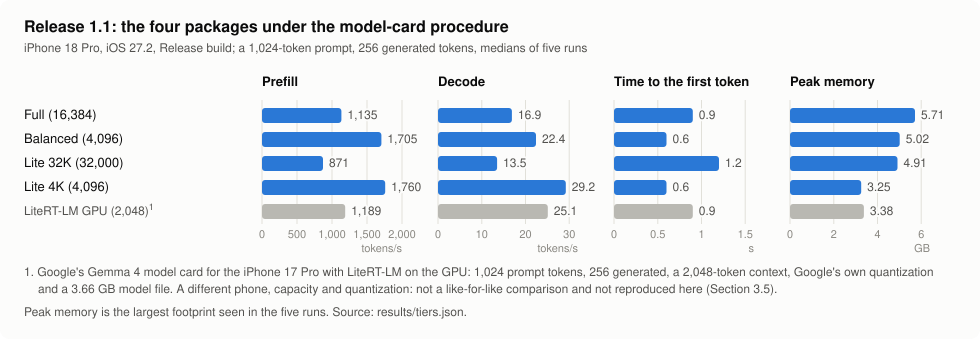
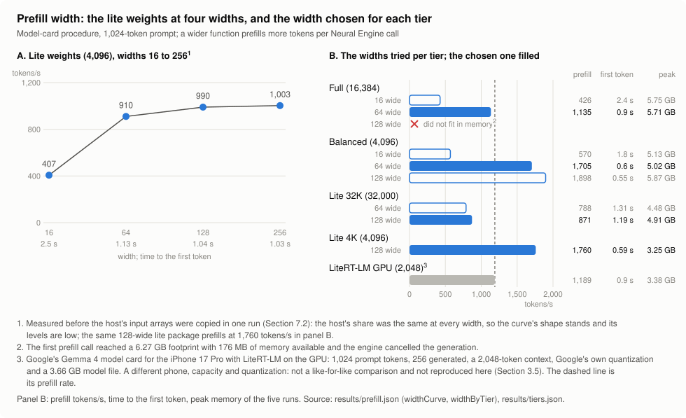
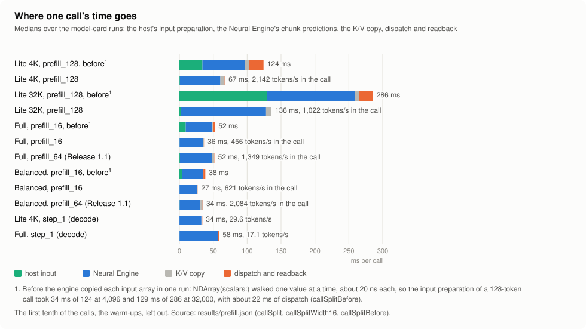

# Running Gemma 4 E4B on the Apple Neural Engine: partitioning, placement, precision and verification

Technical report (draft). This is the engine of the iPhone app within; the app itself is not part of this
repository. Every number below comes from a summary file in [`results/`](results/); Appendix A lists what is
needed to reproduce them.

## Abstract

We describe and evaluate a way to run Gemma 4 E4B (4.5 billion effective parameters, 8 billion including
embedding tables) on a phone system-on-chip so that the decoder's arithmetic runs on the Neural Engine (ANE),
inside the 6 GiB a single app process may use, with a measured and bounded loss of quality. The 42 decoder
layers are exported as seven Core AI assets of six layers each and an eighth asset for the vocabulary head,
which returns its 262,144 logits as 16 slices. The app holds the KV caches: every layer receives its cache as a
read-only input and returns only the keys and values of the current step, because in this graph the ANE
compiler rejects KV kept as model state whenever compressed weights are present. MLP weights are 6-bit
palettized, attention weights INT8, the head INT4; the 6.98 GB of embedding tables stay on the CPU as
memory-mapped FP16 lookups.

The evidence has four layers. Placement: in one trace of three interleaved arms over all eight assets, 96 of
96 Neural Engine calls contain a Neural Engine prediction and none overlaps GPU work of the process, while the
GPU control shows the opposite pattern and two idle recordings contain no predictions. Numerics: all 71 outputs
are within PSNR 35 dB and cosine 0.999 of an FP32 recomputation of the same quantized graph (worst 45.6 dB and
0.99906). Quality: on a frozen set of 200 prompts the negative log-likelihood rises by 0.0213 nats/token over
the FP32 original (limit 0.05). Performance on an iPhone 18 Pro with iOS 27.2: 16.4 tokens/s decode with a
16,384-token KV capacity, 0.62–0.64 s to the first token of a 32-token prompt, a peak footprint of 5.73 GB
during an 11-minute run on battery, and about 9 tokens/s once the device warms and the engine paces itself.
We also report the approaches that failed and what each failure rules out.

Release 1.1 (Section 7) adds three packages of the same model — the same weights at a 4,096-token capacity, and
Google's quantization-aware checkpoint written as palettes at 4,096 and 32,000 tokens (3.18 GB, 29.2 tokens/s in
3.25 GB at 4,096) — a wider prefill (1,760 tokens/s on the lite weights), and KV caches that are continued when a
conversation outgrows its window, across Thinking replies, across stops and, for the system prompt, across
conversations from a file.

## Glossary

| Term | Meaning here |
| --- | --- |
| chunk | One compiled Core AI asset: a contiguous range of decoder layers, or the vocabulary head. Called once per step. |
| step | One call of the decoder for a fixed number of new tokens. Functions are named by width: `step_1` (one token; returns the hidden state or logits, and the fresh K/V) and `step_N` for a wider static width. The shipped package has `step_1` and `prefill_16`. |
| prefill | Feeding the prompt. All prompt tokens but the last pass through the KV-owning chunks only, 16 per call; the last token runs `step_1` through all chunks and yields the first logits. |
| decode | Generating one token per step with `step_1` through all eight chunks. |
| host-held KV | KV caches kept in app memory. Each layer takes its cache as a read-only input and returns the fresh K/V of this step; the host writes them into the cache after the step. |
| owner, donor, consumer | Layers 0–23 own KV. Layers 24–41 own none and reuse the KV of a donor: layer 22 (sliding attention) or layer 23 (full attention). |
| capacity | The number of cache slots of a full-attention layer, fixed when the package is exported (16,384 here). |
| placement | The compute unit that actually executes a call, as observed in a trace, as opposed to the unit requested when loading. |
| arm | One way of loading the same asset in the placement test: Neural Engine preference (candidate), GPU preference or CPU preference (controls). |
| window | The span of one call in a trace, from the start of its inference interval to the end of its readback interval. The unit the placement test counts. |
| lut6 | Weight palettization: each weight is a 6-bit index into a 64-entry table; one table per 16 output channels, with a per-channel scale. |
| PLE | Per-layer embeddings: 256 values per layer per token, looked up from a 262,144 × 10,752 table and merged inside each layer. |
| thermal state | iOS `ProcessInfo.thermalState`: nominal, fair, serious, critical. |

## Results at a glance

| Question | Result | Conditions | File |
| --- | --- | --- | --- |
| Does the decoder run on the ANE? | All 8 chunks: 96/96 candidate windows contain a Neural Engine prediction, 0/96 overlap GPU work of the process; GPU control 0/96 and 96/96; CPU control 0/96 and 0/96; idle recordings 0 predictions in 41.9 s each | iPhone 18 Pro, iOS 27.2, Release build, `step_1` of every chunk | `placement.json` |
| Is each call's arithmetic right? | 71/71 outputs pass; worst PSNR 45.6 dB, worst cosine 0.99906; head keeps the top-1 token, KL 8.5 × 10⁻⁵ nats | against an FP32 recomputation of the same quantized graph on the same input bytes | `numerics.json` |
| Is the whole chain right? | Largest per-item NLL difference 0.0047 nats/token over 28 items (tolerance 0.005) | phone engine against an independent full-sequence recomputation | `numerics.json` |
| How much quality is lost? | +0.0213 nats/token (limit 0.05); worst subset 0.029, worst item 0.102; greedy agreement 95.1% | 200 frozen prompts, 25,040 reference tokens | `quality.json` |
| How fast? | 16.4 tokens/s decode; first token 0.62–0.64 s | KV capacity 16,384; 32-token prompt, 5 × 512 tokens, nominal thermal state at start | `performance.json` |
| How much memory? | Peak 5.73 GB, at least 0.71 GB always available, of a 6.44 GB limit | 11-minute, 20-turn conversation on battery | `sustained.json`, `memory.json` |
| Does it hold up thermally? | Fair after 62 s, never serious; paced to about 9 tokens/s | same run | `sustained.json` |
| Release 1.1: the lighter packages? | Lite 4K (3.18 GB): 29.2 tokens/s decode, 1,760 tokens/s prefill, 0.6 s to the first token of 1,024, 3.25 GB peak; Lite 32K: 13.5 tokens/s and 871 tokens/s in 4.91 GB; Full 16.9 and Balanced 22.4 tokens/s under the same conditions | model-card procedure (1,024-token prompt, 256 generated), Release build, Section 7.1 | `tiers.json` |
| Release 1.1: does the cache survive a full window? | The turn that overflows 32,000 tokens: 5.3 s instead of 35.8 s; kept facts 74/74 and 49/50 against 74/74 and 50/50, facts only the slid cache holds 44/44, health NLL +0.0145 (limit 0.02) | Section 7.3 | `kv_reuse.json` |
| Release 1.1: new chats, Thinking, stops? | A 317-token system prompt read from disk: 0.19 s instead of 3.3 s to the first token; Thinking turns reuse 139–231 of 162–253 tokens; a stopped reply's cache is kept (996 of 1,018 reused) | Full package, Sections 7.4–7.6 | `kv_reuse.json` |

## 1 Problem and constraints

### 1.1 Question

How should a decoder-only language model of the E4B class be partitioned, placed, quantized and verified on a
heterogeneous SoC (CPU, GPU and Neural Engine sharing one memory), with about 6 GB available to the process,
so that the main computation demonstrably runs on the Neural Engine and the quality loss stays within a limit
fixed in advance?

The answer is given as a general recipe (Section 2) with Gemma 4 E4B on an iPhone 18 Pro as its first
instance. Section 2.9 lists what carries over to another model and what has to be redone.

### 1.2 The model

| Property | Gemma 4 E4B ([model card][gemma-card]) and the exported configuration |
| --- | --- |
| Parameters | 4.5 B effective, 8 B including embeddings |
| Decoder layers | 42: five sliding-window layers then one full-attention layer, repeated seven times |
| Widths | hidden 2,560; MLP 10,240; 8 query heads and 2 KV heads; head dimension 256 (sliding) and 512 (full) |
| Sliding window | 512 tokens |
| KV sharing | layers 24–41 compute no K/V; they read the cache of layer 22 (sliding) or 23 (full) |
| Per-layer embeddings | a 262,144 × 10,752 table (42 layers × 256) |
| Vocabulary | 262,144 tokens; the head is tied to the token embedding; final logit soft-capping at 30 |
| Context | 128K tokens supported by the model; 16,384 in the exported package |

### 1.3 Platform constraints

| Constraint | What we measured | Consequence for the design |
| --- | --- | --- |
| One memory, one limit | The process may use 6,442,467,328 bytes (about 6 GiB: footprint plus available memory at the start of the sustained run) with the increased-memory-limit entitlement. | Weights, KV, the touched pages of the lookup tables and the app share this budget. |
| The ANE's copy of the weights is charged to the process | About 1.3 × the chunk file bytes on iPhone 18 Pro / iOS 27.2 (a lut6 package with capacity 4,096: 3.57 GB of chunks → 4.69 GB in the neural footprint); about 1.06 × on iPhone 17 Pro / iOS 27.0. | Compiled weights must stay near 3.5 GB; an all-INT8 package (4.65 GB) does not fit (Section 4.2). |
| Compile or fall back | When the ANE compiler rejects a graph, Core AI compiles it for the GPU and the load still succeeds. | Placement must be measured on the device, for each compiled plan, not inferred from the requested unit. |
| State and compressed weights | KV as Core AI state fails ANE compilation in this layer graph whenever INT8 or palettized weights are present. | KV is held by the host (Section 2.4). |
| Static shapes | KV capacity and input widths are fixed at export; one function exists per width. | One package per capacity; prefill width 16. |
| Size of one compiled graph | A 12-layer chunk failed to specialize; a 42-layer graph exceeded the process limit while its functions were prepared; a 32,768-slot full-attention cache failed ANE conversion while 32,000 compiled. | Chunks of six layers; capacity ≤ 32,000. |
| ANE capacity of one process | On iPhone 17 Pro / iOS 27.0, INT8 chunks loaded onto the ANE in one process up to about 3.4 GB; the next chunk, whichever it was, fell back to the GPU. | Compress the weights rather than add chunks (Section 2.5). |
| No process attribution for ANE activity | The trace table of Neural Engine intervals has no process column (GPU intervals do). | Placement is shown by exclusion and coincidence, with control arms and idle recordings (Section 2.8). |
| Heat | Continuous decode reaches the fair state within about a minute; once serious, the device stays there for minutes even at reduced speed. | The engine paces decode from the fair state (Section 3.7). |

Sources: `memory.json`, `negative.json`, `package.json`, `sustained.json`.

### 1.4 Acceptance criteria

Each layer of evidence has an instrument, a pass rule and a denominator, fixed before the measurement reported
in Section 3.

| Layer | Pass rule |
| --- | --- |
| Placement | Every call of every chunk has a complete, ordered set of trace intervals; all chunks are covered; 0/N candidate windows overlap GPU work of the process and N/N GPU-control windows do; N/N candidate windows contain a Neural Engine prediction and the GPU control has 0/N (or a label-permutation test gives p < 0.001); each idle recording's prediction rate is below 1% of the rate inside candidate windows; the per-call numerics rule below holds. N ≥ 90 per arm. |
| Numerics, per call | Every output: PSNR ≥ 35 dB and cosine ≥ 0.999 against an FP32 recomputation of the same quantized graph on the same input bytes; head: same top-1 token and KL ≤ 10⁻³ nats over the full vocabulary. |
| Numerics, whole chain | Per item, mean NLL on the phone within 0.005 nats/token of an independent recomputation. |
| Quality | Mean NLL increase over the FP32 original ≤ 0.05 nats/token overall, ≤ 0.15 for every subset, ≤ 0.40 for every item. |
| Performance | Median decode ≥ 10 tokens/s and first token ≤ 5 s after warm-up. |
| Memory | Steady-state peak ≤ 6.0 GB; available memory > 200 MB at every 1 Hz sample; no termination by the system. |
| Thermal | Never critical; serious for at most 120 s continuously. |

Two thresholds changed during development, and the change is part of the result. The per-call numerics rule
replaced an element-wise rule (|Δ| ≤ 0.003 + 0.003·|reference| and PSNR > 70 dB) that FP16 execution of this
graph cannot meet on any device, the Mac included (Section 4.8). The memory rule started as 55% of the process
limit and became a 6.0 GB steady-state peak when no format that met the quality limit fitted under 55%
(Section 2.5); transients during loading and the first prefill are excluded from the 6.0 GB rule but not from
the 200 MB and no-termination rules.

## 2 Method

The recipe, in the order it is applied:

1. Establish the platform's constraints with small probes on the target device (Section 2.1).
2. Partition the decoder at boundaries that respect the attention pattern, the KV-sharing structure and the
   compiler's limits; separate the vocabulary head (Section 2.2).
3. Place matrix arithmetic on the ANE and lookups, state bookkeeping and sampling on the CPU (Section 2.3).
4. Hold KV on the host behind an explicit chunk contract (Section 2.4).
5. Choose per-block precision by memory first and quality second, judged on a frozen set (Section 2.5).
6. Measure the data flow and memory of the result (Sections 2.6, 2.7) and verify it in four layers (Section 2.8).

### 2.1 Hardware and constraints


The SoC has three compute units on one unified memory: CPU cores, a GPU and the Neural Engine. Core AI compiles
each asset for a preferred unit on the device, caches the compiled plan, and falls back to the GPU when the ANE
compiler rejects a graph. The constraints in Section 1.3 were established with single-layer and single-chunk
probes built from the real weights (layer 0, or layers 18–23) before any full export: one variable changed per
probe, and the outcome read from the compiler log, the call time and the footprint. Two of them shaped
everything else: the ANE copy of the weights is charged to the process at about 1.3 × their file size, and KV
cannot be model state when the weights are compressed.

### 2.2 Partitioning


The 42 layers are cut into seven chunks of six; the vocabulary head is an eighth chunk with 16 outputs of
16,384 rows each. The chunk contract (`chunk-contract.json` in the package, validated by `Gemma4ChunkContract`)
names every input and output of every function.

| Chunk | Layers | KV | Functions | `main.mlirb` |
| --- | --- | --- | --- | --- |
| 0–3 | 0–5, 6–11, 12–17, 18–23 | owns its six layers' KV | `step_1`, `prefill_16` | 459.5–459.6 MB |
| 4–6 | 24–29, 30–35, 36–41 | reads donors 22 and 23 | `step_1` | 440.9 MB |
| 7 | vocabulary head | — | `step_1` (16 logit slices) | 336.1 MB |

Why six layers:

- **Upper bound.** Larger graphs failed: a 12-layer chunk failed to specialize (cause not established), a
  single 42-layer FP8 graph exceeded the process limit during function preparation, and a staged FP16 graph
  failed ANE compilation. Six-layer INT8 chunks of at most 0.58 GB each compiled for the ANE. A per-graph size
  limit between six and twelve layers was not located; the process's ANE capacity (Section 1.3) is a separate
  limit on the sum of all chunks.
- **Lower bound.** Each call has a fixed cost. Single-call probes of INT8 host-KV layers took 2.71, 3.85 and
  5.23 ms for one, two and three layers (iPhone 17 Pro): about 1.26 ms per layer plus 1.4 ms per call. Smaller
  chunks multiply the fixed cost; with six layers per chunk a token costs eight calls.
- **Structure.** Six is one period of the attention pattern, so every layer chunk has the same shape (five
  sliding layers, then one full-attention layer), and the KV-sharing boundary at layer 24 falls between chunks:
  chunks 0–3 only own KV and chunks 4–6 only consume it. Owner chunks carry a prefill function; consumer chunks
  need none, because layers 24–41 produce no KV and so only the last prompt token has to pass through them.

Why a separate head split into 16 slices: as its own chunk the head can take its own format (INT4 while the
layers are not), and as a single 262,144-wide output it took 27 ms per call against 14.4 ms as 16 independent
slices (INT8 head, iPhone 17 Pro); the host concatenates the slices. In the first INT8 package the head shared a
chunk with layers 36–41 (1.23 GB), which ran on the GPU at 54 ms per call; later runs traced that fallback to the
process's ANE capacity rather than to the chunk's size (Section 4.2). In the shipped format (INT4) the head's
median Neural Engine busy time is 3.8 ms per call.

What was not done: a sweep over chunk sizes in the shipped format. Six layers is a size that works and is
bounded on both sides by measurements, not a measured optimum.

### 2.3 Placement

| Work | Unit | Reason |
| --- | --- | --- |
| All 42 decoder layers: projections, attention, norms, MLP, PLE merge | ANE (chunks 0–6) | Almost all of the arithmetic; the placement under test. |
| Vocabulary head, 2,560 → 262,144 | ANE (chunk 7) | The largest single matrix product per token. |
| Token and per-layer embedding lookup | CPU | One row per token from 6.98 GB of tables: no arithmetic. As graph constants the tables would count toward the ANE copy charged to the process; memory-mapped, only the touched rows are read. |
| RoPE tables and attention masks | CPU | Small and position-dependent; computing them on the host keeps every graph static. |
| KV write-back | CPU | Follows from host-held KV (Section 2.4). |
| Logit concatenation and sampling | CPU | 262,144 values per token; temperature, top-K and top-P. |
| Tokenizer and chat template | CPU | Text processing. |
| — | GPU | No work in the shipped path; used only as a control arm. The ANE package on Core AI's GPU backend was not usable (Section 4.7). |

Over the 11-minute sustained run the process used 159.1 s of CPU time in 660 s of wall time, about a quarter of
one core, including the app's interface.

### 2.4 State: host-held KV

The contract for an owner layer *n*: inputs `key_n` and `value_n` of shape [1, 2, *D*, *C*], read only; outputs
`fresh_key_n` and `fresh_value_n` of shape [1, 2, *D*, *L*] for the *L* tokens of the call; after the call the
host writes the fresh values into slots (*p* + *i*) mod *C*. Attention inside the graph runs over the *C* cached
slots followed by the *L* fresh ones, with masks from the host.

| Layer kind | Layers with KV | Slots *C* | Host bytes (FP16) |
| --- | --- | --- | --- |
| Sliding attention (*D* = 256) | 20 | 512, used as a ring | 20,971,520 |
| Full attention (*D* = 512) | 4 | 16,384 | 268,435,456 |
| Total |  |  | 289,406,976 (0.29 GB) |

Layers 24–41 own no KV. Chunks 4–6 receive the caches of donor layers 22 and 23 plus this step's fresh K/V of
those two layers from chunk 3, because the host writes the caches back only after the whole step.

Why not model state: probes on two devices and two OS releases (Section 4.1) show that in this layer graph KV
kept as Core AI state compiles for the ANE only without compressed weights, while the same layers with
host-held KV compile and run. The finding is scoped to this graph: Apple's iOS recipe combines palettized
weights with state for other models.

What host-held KV costs and gives:

- Every call binds the full caches of its layers as inputs: 0.49 GB of cache tensors per decode step at
  capacity 16,384 (derived from the contract's shapes). Allocating the caches from the function's own input
  descriptor gave the same layout and footprint, so no zero-copy path was found in the public API. Decode time
  therefore depends on the compiled capacity, not on the position: the same engine decodes at 16.4 tokens/s
  with capacity 16,384 and 21.6 tokens/s with 4,096.
- Capacity is fixed per package; packages that carry several capacities are slower at every capacity
  (Section 4.5).
- The host owns the state. A conversation's caches can be written to disk and read back: after a reload,
  restoring a 13.7K-token conversation gave the first token in 1.27 s, against 54 s to prefill it again.
  A new prompt that extends exactly the tokens in the cache is fed incrementally.
- Ring buffers keep the 20 sliding layers at 512 slots: 0.29 GB of KV in total, against 0.94 GB if those
  layers held all 16,384 slots (derived).

The ring and the prefill schedule are checked against a recomputation without a ring buffer (Section 3.3).

### 2.5 Precision

| Tensors | Format | Package bytes | Reason |
| --- | --- | --- | --- |
| MLP gate, up, down: 42 × 3 × 2,560 × 10,240 = 3.30 B weights | lut6: 6-bit k-means palette, one 64-entry table per 16 output channels, per-channel scale | about 2.48 GB of the 3.50 GB of chunks (derived) | The largest block. The 4-bit formats that the ANE compiles failed the quality limit; INT8 does not fit. |
| Attention q, k, v, o; per-layer-embedding projections | INT8 per output channel, symmetric, weight-only | the rest of the layer chunks | Near-lossless; compressing attention further cost more quality than it saved memory. |
| Vocabulary head (tied to the embedding) | INT4 per output row, 16 slices | 336.1 MB | Half of the INT8 head (about 672 MB); its share of the 4-bit-MLP loss below was about 0.013. |
| Token and per-layer embedding tables | FP16, outside the graphs | 6.98 GB | Lookups only (Section 2.3). |
| Activations, KV, norms | FP16 | — | The ANE's native type. |

The format was chosen by memory first, then quality, on subsets of the frozen quality set (Section 3.4), with
the exporter's own rounding recomputed on the Mac:

| Configuration | Items | NLL increase (nats/token) | Outcome |
| --- | --- | --- | --- |
| FP16 graph, no weight rounding | 20 | 0.00002 | The graph is lossless; the loss comes from rounding. |
| All projections INT8 | 20 | 0.002 | Passes quality; does not fit in memory. |
| MLP INT4 per channel, head INT4 | 20 | 0.286 | Fails. |
| MLP INT4 in blocks of 32 input channels | — | — | Not converted for the ANE (a 6-layer probe fell back to the GPU at 76–78 ms). |
| MLP lut4, head INT4 | 18 | 0.0997 | Fails. |
| MLP lut4 on down only / on gate and up only | 18 | 0.045 / 0.073 | The losses add up; no single projection carries them. |
| MLP lut4 with input-moment-weighted k-means | 18 | 0.103 | No gain. |
| MLP and attention lut4 | 18 | 0.153 | Saves about 275 MB for +0.053. |
| **MLP lut6, head INT4 (shipped)** | 18 | 0.023 | Passes; the full 200-item run on the phone gives 0.0213. |

Replacing one layer's gate and up projections at a time cost at most +0.004 per layer, spread over layers
11–41, so no small set of layers could be given more bits to recover the 4-bit loss. One exporter error found on
the way is worth recording for anyone repeating this: the per-layer-embedding projections live in the same
module as the MLP, and quantizing them to INT4 along with it added +0.47 on its own; keeping them at INT8 costs
about 27 MB.

Sources: `quality.json` (`formatAlternatives`), `negative.json`.

### 2.6 Data flow of one token


Decode, one token at position *p*:

1. CPU: look up the embedding row (scaled by √2,560) and the 42 × 256 per-layer values (scaled by √256);
   compute RoPE cos/sin (θ = 10,000 for sliding layers; θ = 1,000,000 with a quarter of the dimensions rotated
   for full layers) and the masks.
2. ANE, chunks 0–3 (`step_1`): hidden state, embedding row, the chunk's six layers' PLE rows, RoPE, masks and
   caches in; hidden state and twelve fresh K/V tensors out.
3. ANE, chunks 4–6 (`step_1`): the same inputs, with the donor caches and donor fresh K/V instead of own caches;
   hidden state out.
4. ANE, chunk 7: hidden state in, 16 logit slices out. CPU: concatenate, sample.
5. CPU: write the 24 owner layers' fresh K/V into slot *p* mod 512 (sliding) or *p* (full).

Time per step. In the placement recording the median Neural Engine busy time per call is 6.65–7.17 ms for the
layer chunks and 3.80 ms for the head, 52.8 ms in total. The product's median token interval in the performance
procedure is 60.7–61.1 ms per unpaced run (16.4 tokens/s). The difference, about 8 ms, is host work and call
overhead; it is an estimate from two different runs, not a measurement.

Prefill. A prompt of *n* tokens is fed as ⌊(*n* − 1)/16⌋ calls of `prefill_16` and (*n* − 1) mod 16
single-token calls, each through chunks 0–3 only, then one `step_1` through all eight chunks for the last token.
A 32-token prompt is therefore 1 + 15 owner-chunk calls and one full step; its first token arrives after a
median of 0.62–0.64 s. Long prompts: in the sustained run, two turns whose cache could not be reused
re-prefilled 1,419 and 2,544 tokens and produced their first token after 5.24 s and 9.32 s (about 270 tokens/s,
derived).

Memory per step. Without preallocated outputs, Core AI allocated new output arrays on every call, about
23.2 MiB per token (mostly the head's 16 logit slices, whose output buffers are padded), and released them only every few tokens. Binding the outputs
of `step_1` to arrays allocated once at load (`Gemma4StateStorage`) reduced the growth to about 2.9 MiB per
token and the head's call time from 7.2 to 3.6 ms.

### 2.7 Memory map


| Component | Size | Where | Source |
| --- | --- | --- | --- |
| Process limit | 6,442,467,328 B (about 6 GiB) | — | `memory.json` |
| Chunk files | 3,496,985,782 B | flash; compiled plans cached by the system | `package.json` |
| ANE working copy of the weights | about 1.3 × chunk bytes | charged to the process | `memory.json` |
| Host KV | 289,406,976 B | app heap | `package.json` (derived) |
| Embedding tables | 6,979,321,856 B | memory-mapped read-only; only touched rows are read | `package.json` |
| Steady-state peak, shipped engine | 5.65–5.73 GB | — | `memory.json` |
| Minimum available, 11-minute run | 0.71 GB | — | `sustained.json` |

The first decode after a load used to be the peak. Without preallocated outputs, a cold start with a short
prompt peaked at 5.985 GB, the first decode after a 13.6K-token prompt at 6.195 GB (0.248 GB available) and the
first decode after a reload and KV restore at 6.303 GB (0.139 GB available), while the steady state
mid-conversation was 5.82–5.95 GB. The engine's causes were the per-call output allocation above and file-read buffers
kept alive after a KV restore. With preallocated outputs and reads straight into the caches, the same three
scenarios peaked at 5.692, 5.720 and 5.669 GB (Debug builds). In the 11-minute Release run the peak, 5.73 GB,
came at 283 s, mid-conversation.

There is no exact breakdown of the shipped peak by component: the neural footprint and the app's own regions
were measured on a sister package (capacity 4,096), and the two accounts overlap.

### 2.8 Verification system

| Layer | Instrument | Rules out | Does not rule out |
| --- | --- | --- | --- |
| Placement | One process, three arms (Neural Engine, GPU, CPU preference) of the same assets, interleaved, recorded with all-process tracing; two idle recordings (Section 3.2) | GPU execution of chunk calls by this process; a silent GPU fallback after a compile failure; a chunk missing from the ANE plan; ANE activity of an idle system above 1% of the in-window rate | Which operation ran on the ANE; ANE activity of other processes inside a window (bounded, not excluded); CPU execution (CPU time was not sampled); placement of `prefill_16` (not traced) |
| Numerics, per call | FP32 recomputation of each chunk's quantized graph from the call's own input bytes, with Mac FP16 as a fourth arm (Section 3.3) | Wrong arithmetic in a compiled plan (the CPU arm is caught); errors that appear on one unit only | Quantization loss (same representation by construction); behavior on real conversation caches (inputs are seeded random caches) |
| Numerics, whole chain | Teacher-forced NLL on the phone against an independent full-sequence recomputation with the same rounding (Section 3.3) | Host-side errors: lookups, masks, ring buffer, prefill schedule, KV write-back | Effects specific to the shipped device (measured on an iPhone 17 Pro at capacity 4,096) |
| Quality | NLL increase over the FP32 original on a frozen 200-prompt set (Section 3.4) | Quantization damage beyond the budget, per subset and per item | Task-level accuracy; long generations; thinking mode |
| Performance, memory, thermal | Frozen procedures with fixed prompts, counts and thresholds (Sections 3.5–3.7) | Regressions in speed, memory and heat under the defined workloads | Other devices and ambient conditions; energy |

The layers complement each other: placement alone could pass for a wrong graph and numerics alone could pass for
a GPU plan, which is why the per-call numerics rule is part of the placement verdict.

### 2.9 Transferring the recipe

| Step | Carries over | Redo for a new model or device |
| --- | --- | --- |
| Constraint probes | The probe design: one layer of real weights, one variable at a time, compile log plus call time plus footprint | All results. The residency ratio changed from about 1.06 to about 1.3 between two devices and OS releases. |
| Partition | Cut at multiples of the attention period and at the KV-sharing boundary; split the head into row slices; owner chunks get a prefill function | Chunk size, number of head slices, size limits |
| Placement | Lookups, RoPE, masks and sampling on the CPU; matrix work on the ANE | Check that nothing else is large enough to need the ANE |
| State | The host-held KV contract, rings for sliding layers, donor passing for shared KV | Whether model state compiles with the chosen weight format; capacity |
| Precision | INT8 baseline, memory check, compress the largest block, judge on a frozen set against the original model | Every number; the set's baseline |
| Verification | Arms, idle controls, window counting, FP32 same-representation reference, NLL fidelity, quality limits, procedures | The reference implementation of the new model; the quality set's baseline continuations |

## 3 Evaluation

### 3.1 Setup

| Item | Value |
| --- | --- |
| Device | iPhone 18 Pro (iPhone19,2), iOS 27.2 (24B5089g) |
| App | Release build; its engine is the code in `Sources/` as built into the app when measured (Appendix A.1) |
| Package | The shipped package (Appendix A.2). Part of the evidence was recorded on an earlier export of the same graphs and weights, equivalent by the definition in Appendix A.3. |
| Exceptions | Whole-chain numerics: iPhone 17 Pro, iOS 27.0, Debug build, capacity 4,096 (Section 3.3). Probes in Sections 2 and 4 name their device. |

### 3.2 Placement


Design. In one process, each chunk's asset is loaded three times, with Neural Engine, GPU and CPU preference,
and its `step_1` function is called 12 times per arm with identical inputs, the arm order rotating every round;
chunks run one at a time, because three copies of the model do not fit. The inputs are the product's decode
inputs for one token at position 1,000 with seeded random caches; each chunk reads the candidate arm's outputs
of the previous chunk. Every call is bracketed by three signposted intervals (input materialization, inference,
readback). The trace covers all processes and starts before the app. After the workload, two idle recordings of
the same length are made with the app terminated.

| Criterion | Neural Engine (candidate) | GPU (control) | CPU (control) |
| --- | --- | --- | --- |
| Calls with complete, ordered intervals | 288 of 288 across the three arms; 0 unfinished, 0 unexpected; trace files unchanged since recording | | |
| Chunks covered | 8 of 8 | 8 of 8 | 8 of 8 |
| Windows overlapping GPU work of this process | 0 / 96 | 96 / 96 | 0 / 96 |
| Windows containing a Neural Engine prediction | 96 / 96 | 0 / 96 | 0 / 96 |
| Share of window time with GPU work of this process | 0.0 | 0.503 | 0.0 |
| Median window | 9.04 ms | 21.57 ms | 23.27 ms |

Every candidate window contains exactly one Neural Engine prediction interval; inside candidate windows they
occur at 100.4 per second. The two idle recordings (41.9 s each) contain none, below the 1% bound. Because the
GPU control had no window with a prediction, the rule's stricter branch decides; the label-permutation test is a
fallback for a control with some predictions and was not exercised (the review stores p = 0.0 for this branch,
which is not a computed p-value). The numerics criterion is reported in Section 3.3. Verdict: pass.

| Chunk | Median candidate window | Median ANE busy | ANE share of window | GPU-control GPU share |
| --- | --- | --- | --- | --- |
| 0 | 9.33 ms | 7.15 ms | 0.779 | 0.555 |
| 1 | 9.23 ms | 7.17 ms | 0.780 | 0.564 |
| 2 | 9.13 ms | 7.11 ms | 0.777 | 0.565 |
| 3 | 9.16 ms | 6.99 ms | 0.782 | 0.568 |
| 4 | 8.25 ms | 6.65 ms | 0.814 | 0.344 |
| 5 | 8.62 ms | 7.03 ms | 0.814 | 0.338 |
| 6 | 8.62 ms | 6.86 ms | 0.803 | 0.337 |
| head | 8.69 ms | 3.80 ms | 0.442 | 0.746 |

The GPU and CPU arms run the package compiled for the ANE; their window times are those of control arms, not a
benchmark of either unit.

What this can and cannot prove:

- The proof is by exclusion plus coincidence, not attribution: it cannot show which operation ran on the ANE.
- ANE hardware rows carry no process: the idle control bounds, and does not exclude, rows from other processes
  inside a window.
- Only the instrumented stages (input materialization, inference, readback) are covered.
- Compute preference, numerical acceptance, capture coverage and hardware placement are separate conclusions.

Two further gaps: the process's CPU time was not sampled (the recording template had no time-profile table), so
the CPU control is identified by the absence of both signals; and the Core AI execution table returned no rows
in this recording, for a reason not yet diagnosed, so per-call Core AI attribution is not part of the verdict.

Source: `placement.json`.

### 3.3 Numerics

Per call. The round-0 inputs and outputs of the placement recording are scored against an FP32 recomputation of
each chunk on the Mac: the chunk is rebuilt from the checkpoint with the exporter's own quantization and
evaluated in FP32 on the phone's input bytes. The same graph evaluated in FP16 on the Mac is scored as a fourth
arm. Each chunk is scored on its own inputs, so errors do not accumulate across chunks here.

| Chunk | Outputs | Neural Engine: min PSNR / min cosine | GPU | CPU | Mac FP16 |
| --- | --- | --- | --- | --- | --- |
| 0 | 13 | 48.3 dB / 0.999892 | 46.9 / 0.999735 | 25.2 / 0.941976 | 54.2 / 0.999952 |
| 1 | 13 | 55.9 / 0.999959 | 54.9 / 0.999969 | 37.4 / 0.998965 | 54.4 / 0.999968 |
| 2 | 13 | 45.6 / 0.999063 | 52.4 / 0.999926 | 37.3 / 0.994197 | 50.4 / 0.999790 |
| 3 | 13 | 55.1 / 0.999842 | 55.2 / 0.999958 | 36.7 / 0.992097 | 52.9 / 0.999901 |
| 4 | 1 | 75.1 / 0.999982 | 80.7 / 0.999995 | 59.4 / 0.999346 | 79.9 / 0.999994 |
| 5 | 1 | 76.6 / 0.999992 | 73.9 / 0.999984 | 60.6 / 0.999649 | 74.6 / 0.999986 |
| 6 | 1 | 83.4 / 0.999997 | 87.1 / 0.999999 | 69.5 / 0.999931 | 86.2 / 0.999999 |
| head | 16 slices | 60.9 / 0.999999 | 79.3 / 1.000000 | 68.2 / 1.000000 | 74.8 / 1.000000 |

Owner chunks return the hidden state and twelve fresh K/V tensors; consumer chunks return only the hidden state.

| | Neural Engine | GPU | CPU | Mac FP16 |
| --- | --- | --- | --- | --- |
| Outputs failing PSNR ≥ 35 dB and cosine ≥ 0.999 | 0 / 71 | 0 / 71 | 16 / 71 | 0 / 71 |
| Outputs passing the old element-wise rule (\|Δ\| ≤ 0.003 + 0.003·\|ref\|, PSNR > 70 dB) | 8 / 71 | 9 / 71 | 0 / 71 | 9 / 71 |
| Head: top-1 equal / KL (nats) / top-10 overlap | yes / 8.5 × 10⁻⁵ / 10 | yes / 3.9 × 10⁻⁶ / 10 | yes / 3.9 × 10⁻⁵ / 10 | yes / 3.3 × 10⁻⁵ / 10 |

The thinnest margin is chunk 2's hidden state: cosine 0.99906 on the ANE (relative L2 error 4.3%), against 2.1%
for the Mac FP16 run and 1.2% for the GPU. The ANE, the GPU and Mac FP16 are at the same level of error; the Core
AI CPU arm is not (worst output 25.2 dB; chunk 0's hidden state at cosine 0.94; failing outputs in chunks 0–3),
so the rule separates a correct plan from an incorrect one. The CPU backend is not on the shipped path and was
not investigated further.

Whole chain. Teacher-forced NLL from the product engine on the phone (lookups, all chunks, host KV with 512-slot
rings, the prefill schedule) was compared item by item with an independent recomputation that builds the same
rounded graph in PyTorch FP16 and runs each sequence in one pass without a ring buffer.

| Items | Coverage | Largest difference | Tolerance |
| --- | --- | --- | --- |
| 22 from the quality set | all five subsets | 0.0022 nats/token | 0.005 |
| 6 window-boundary items | prefill ending at 511, 512, 513; decode across 511–513; decode across the ring's second wrap (1,023–1,025); a control at 300 | 0.0047 nats/token (prefill ending at 512) | 0.005 |

Conditions: iPhone 17 Pro, iOS 27.0, Debug build, a package with the same chunking and formats at capacity
4,096. The three items that cross the window boundary (prefill ending at 511 and at 512, decode across 511–513) use
77–94% of the tolerance, against at most 0.0022 for the
others; the masks were checked to be equivalent and the difference is numerical (ring buffer against
whole-sequence masking), measured on one text at three positions. The result was recomputed from the raw
receipts by three independent scripts with identical results.

Source: `numerics.json`.

### 3.4 Quality

The quality test set is frozen and identified by its SHA-256; its contents are not published, because the long
subset contains unpublished text.

| Subset | Items | Content | Prompt tokens (min / median / max) | Reference tokens |
| --- | --- | --- | --- | --- |
| en | 60 | English, single turn | 14 / 21 / 39 | 7,429 |
| zh | 60 | Simplified Chinese, single turn | 15 / 20 / 39 | 7,553 |
| multi | 40 | four user turns with three fixed assistant turns, 20 English and 20 Chinese | 100 / 121 / 156 | 4,938 |
| code | 20 | write, explain or fix code in nine languages | 24 / 34 / 74 | 2,560 |
| long | 20 | at least 1,500 tokens of first-party documents or source plus a task, English and Chinese | 1,556 / 2,484 / 3,821 | 2,560 |
| total | 200 | | | 25,040 |

Set SHA-256 `a2214c774c535a6f0e5f6478368adab68b45074013be80ca527b5de0d7f3d316`; reference continuations SHA-256
`9880394ec5f99e1c54aa2f225b70b4cd9e671a3eb5f5e9e38609026844512d13`.

Definition. Prompts are rendered with the checkpoint's own chat template (thinking disabled, no system prompt).
The original model generated each reference continuation greedily (at most 128 tokens), and both were frozen
before any candidate was scored. The baseline is the original checkpoint in FP32 on a Mac CPU. The metric is the
mean negative log-likelihood of the reference tokens under teacher forcing, prompt tokens excluded; the reported
delta is candidate minus baseline, weighted by tokens. On the phone the product engine computes it from its FP16
logits, accumulating in double precision.

| Subset | Baseline NLL | Phone NLL | Increase | Limit | Greedy agreement |
| --- | --- | --- | --- | --- | --- |
| en | 0.1806 | 0.1983 | 0.0177 | 0.15 | 95.9% |
| zh | 0.2592 | 0.2882 | 0.0290 | 0.15 | 93.8% |
| multi | 0.2866 | 0.3140 | 0.0275 | 0.15 | 93.5% |
| code | 0.0816 | 0.0880 | 0.0063 | 0.15 | 98.0% |
| long | 0.2428 | 0.2546 | 0.0118 | 0.15 | 97.0% |
| **all** | 0.2215 | 0.2427 | **0.0213** | 0.05 | 95.1% |

No item exceeds 0.40; the largest item increase is 0.102. The 200 per-item NLL sums were identical, bit for bit,
to those of an earlier Debug run of the 4,096-capacity package on an iPhone 17 Pro with iOS 27.0: capacity,
device, OS and build configuration did not change any value.

What the number means: under teacher forcing on the original model's own continuations, the quantized model
assigns them on average e^0.0213 ≈ 1.02 times lower likelihood per token. It is not a task accuracy.

Source: `quality.json`.

### 3.5 Performance

Procedure: a fixed 32-token prompt, no system prompt, thinking off, temperature 0.7, top-K 64, top-P 0.95; three
warm-up generations of 64 tokens; five runs of exactly 512 tokens (stop tokens suppressed), each starting in the
nominal thermal state; speed of a run = 1000 / median interval over tokens 33–512; reported speed = median of the
five runs; first token = request to first sampled token, after warm-up.

| Package | Median speed | Runs (tokens/s) | First token, median / max |
| --- | --- | --- | --- |
| evidence export | 16.43 tokens/s | 16.44, 16.43, 16.38, 16.46, 9.04 | 0.64 s / 0.89 s |
| shipped export | 16.41 tokens/s | 9.06, 16.43, 16.37, 16.47, 16.41 | 0.62 s / 1.55 s |

In each set one run reached the fair state early and was paced for most of its tokens (median interval about
110 ms); the median of five is not affected. Some runs waited up to 235 s for the nominal state before starting.
The first generation after loading took 2.30–2.99 s to its first token. Loading the package for the first time
compiles all eight chunks for the ANE (138 s, Debug build); later launches load from the system's compile cache
(6 s).

Capacity. The same engine with a 4,096-slot package decodes at 21.6 tokens/s against 16.4 with 16,384 (cold start,
512 tokens, Debug build, plugged in), because every step binds the full caches.

Published figures for comparison. Google publishes LiteRT-LM figures for Gemma 4 E4B on an iPhone 17 Pro
([model card][litert-card]; also the [developer page][litert-dev]):

| | This work | LiteRT-LM GPU | LiteRT-LM CPU |
| --- | --- | --- | --- |
| Device | iPhone 18 Pro | iPhone 17 Pro | iPhone 17 Pro |
| Compute unit for the decoder | ANE | GPU | CPU |
| Context capacity | 16,384 | 2,048 | 2,048 |
| Decode | 16.4 tokens/s | 25.1 tokens/s | 9.7 tokens/s |
| Prefill | about 270 tokens/s (derived, Section 2.6) | 1,189 tokens/s | 159 tokens/s |
| First token | 0.62–0.64 s for 32 tokens | 0.9 s for 1,024 tokens | 6.5 s for 1,024 tokens |
| Peak memory (phys_footprint) | 5.73 GB | 3,380 MB | 961 MB |
| Model download | 10.5 GB | 3.66 GB | 3.66 GB |

These are not like-for-like: different device generations, runtimes, compute units, weight formats and context
capacities, and we did not run Google's conditions (1,024 prompt tokens, 256 generated, context 2,048). On the
published numbers, the GPU path on the previous phone generation decodes about 1.5 times faster, prefills about
four times faster and uses less memory than this ANE path; this work keeps the GPU idle and holds a 16,384-token
context. Energy is not compared: Google does not publish it, and we could not measure it (Section 3.7). A
third-party project reports 15.7 tokens/s for a Gemma 4 E4B build on the iPhone 17 Pro's Neural Engine with INT8
chunks and a 2,048-token context ([CoreML-LLM][coreml-llm]).

Source: `performance.json`.

### 3.6 Memory

| Scenario | Peak footprint | Minimum available | Build |
| --- | --- | --- | --- |
| 11-minute sustained run | 5.73 GB | 0.71 GB | Release |
| Cold start, 512 tokens | 5.65 GB | 0.79 GB | Debug, optimized |
| Cold start, 13.7K-token prompt | 5.720 GB | 0.723 GB | Debug |
| Reload and KV restore | 5.669 GB | 0.774 GB | Debug |
| Capacity 4,096, cold start, 512 tokens | 5.027 GB | 1.415 GB | Debug |

All are within the 6.0 GB steady-state rule with more than 0.7 GB available. Earlier variants and rejected
packages are in the figure of Section 2.7 and in Section 4.

Source: `memory.json`.

### 3.7 Sustained use and thermal behaviour

Workload: one conversation of 20 turns of exactly 256 tokens, 5 s between turns, at least 10 minutes, twelve fixed
English and Chinese prompts, temperature 0.7, top-K 64, top-P 0.95, thinking off. Environment: airplane mode,
screen on at 50% brightness, unplugged, battery at 85%, nominal thermal state at the start, Release build. Ambient
temperature was not recorded.

| Measure | Result | Rule |
| --- | --- | --- |
| Duration, tokens | 660 s, 5,120 output tokens | ≥ 600 s |
| Crashes, terminations | none; no unclean previous launch | none |
| Peak footprint | 5.73 GB (at 283 s) | ≤ 6.0 GB |
| Minimum available | 0.71 GB | > 200 MB |
| Thermal samples (every 5 s) | 12 nominal, 117 fair, 0 serious, 0 critical; fair from 62 s | never critical, serious ≤ 120 s |
| Decode interval | 61–63 ms for turns 1–3, about 110 ms from turn 4 | — |
| First token | 2.73 s for turn 1 (after load); 0.38–0.74 s when the cache was reused (17 of 19 later turns) | — |
| Energy | not measurable: the battery level stayed at 85% | recorded only |

The engine paces decode once the device leaves the nominal state: a token takes at least 110 ms in the fair state
and 200 ms in serious or critical. The reason is that iOS leaves the serious state slowly: with 92 ms pacing at
fair, a plugged-in run of the same format reached serious at 484 s and stayed there for 204 s, longer than the
120 s rule. The cost is visible above: after about a minute of continuous generation the speed is about
9 tokens/s, below the 10 tokens/s floor of the performance rule (Section 1.4), which is measured from a nominal start.

Two later turns did not reuse the cache because the conversation's text re-tokenized differently from the
generated tokens; they re-prefilled 1,419 and 2,544 tokens.

Source: `sustained.json`.

## 4 Negative results

| | Approach | Result | Consequence |
| --- | --- | --- | --- |
| 4.1 | KV as Core AI state with compressed weights | ANE compilation fails in every tested combination | Host-held KV |
| 4.2 | All-INT8 weights | Does not fit: terminated during prefill | Compress the MLP |
| 4.3 | 4-bit MLP formats | Fail the quality limit or the ANE conversion | 6-bit palettes |
| 4.4 | Larger graphs: 12-layer chunks, whole-model graphs | Fail to compile or exceed the process limit | Six-layer chunks |
| 4.5 | Packages with several KV capacities | Slower at every capacity | One capacity per package |
| 4.6 | 32K context | Terminated; 32,768 slots do not convert | Capacity 16,384 |
| 4.7 | This package on Core AI's GPU backend | Terminated, or 13–16 s per token | GPU only as a control |
| 4.8 | Element-wise numerics rule at 70 dB | Not attainable by FP16 execution | PSNR, cosine and KL rule |
| 4.9 | Trusting a cached compiled plan | A recompile can land off the ANE | Placement re-checked per plan |
| 4.10 | Attention per query head | Slower than per KV head | Grouped attention |

**4.1 State with compressed weights.** Single-layer probes (real layer-0 weights, capacity 512):

| Device, OS | Fails ANE compilation | Compiles |
| --- | --- | --- |
| iPhone 17 Pro, iOS 27.0 | INT8 whole layer, INT8 attention only, INT8 MLP only, each with KV as state | FP16 with state; INT8 per-layer-embedding projections only, with state; state update only; INT8 layer with host-held KV |
| iPhone 18 Pro, iOS 27.2 | INT8 with state | FP16 with state; INT8 with host-held KV (1.5 ms per call) |
| iPhone 18 Pro, iOS 27.2 | lut6 MLP; lut6 attention and MLP; the shipped mix; lut6 without per-channel scale; lut4 in groups of 32 without scale (the default iOS palettization preset) — each with state | — |

Every failure reports the same compiler error ("MLIR MPS to ANEC conversion failed"). Removing the per-channel
scale did not help, so the failure is not the palette's table shape. Splitting compressed projections and stateful
attention into separate graphs would cost about three calls per layer (around 126 per token) and was not pursued.
A seven-chunk stateful INT8 export compiled for the GPU instead and exhausted the phone's storage during the
fallback compile.

**4.2 INT8 does not fit.** On the iPhone 18 Pro an all-INT8 package (4.65 GB of chunks, capacity 4,096) reached a
6.18 GB footprint at its first inference and was terminated during prefill; the same measurement on the lut6
package showed the ANE copy at about 1.3 × the chunk bytes for both formats, so the palettes are not being
expanded. On the iPhone 17 Pro with iOS 27.0, chunks loaded onto the ANE in one process up to about 3.4 GB, after
which the next chunk, whichever it was, failed to map and fell back to the GPU (8.38 tokens/s with six chunks on
the ANE). The seventh chunk of that package also held the head (1.23 GB, the only chunk above 1 GB) and ran on
the GPU at 54 ms per call. After the head moved to a chunk of its own, the seventh chunk (layers 36–41 alone)
failed in the same way, also when the first six were loaded from the compile cache without compiling, which
points to the process's capacity rather than to the size of the combined chunk.

**4.3 4-bit MLP formats.** See the table in Section 2.5: INT4 per channel +0.286 and lut4 +0.0997 nats/token on
18–20-item subsets, against a limit of 0.05; INT4 in blocks of 32 input channels did not convert for the ANE.

**4.4 Larger graphs.** A 12-layer chunk failed to specialize (cause not established). A single 42-layer FP8 graph
specialized, but preparing its functions pushed the footprint to 5.5–6.5 GB and the process was killed at the
per-process limit; a staged FP16 graph failed ANE compilation and fell back to a full GPU compile.

**4.5 Several capacities in one package.** Functions for several capacities can share one set of weights in one
asset. On the iPhone 18 Pro (Debug, plugged in, 512 tokens, without preallocated outputs):

| Package, at capacity | Tokens/s | Peak |
| --- | --- | --- |
| single 4,096, at 4,096 | 19.5 | 5.44 GB |
| two capacities, at 4,096 | 12.3 | 5.23 GB |
| four capacities, at 4,096 | 16.8 | 6.27 GB |
| single 16,384, at 16,384 | 14.4 | 5.995 GB |
| two capacities, at 16,384 | 11.5 | 5.45 GB |
| four capacities, at 16,384 | 11.3 | 6.30 GB |

The slowdown is in the ANE calls, not on the host. The four-capacity package also peaked about 0.8 GB higher at
4,096 (6.27 against 5.44 GB) and left 0.12–0.17 GB available.

**4.6 32K context.** The four-capacity package at 32,000 reached 6.44 GB and was terminated after 8 tokens. A
32,768-slot cache failed ANE conversion even alone (GPU at about 90 ms per call for six layers); 32,000 compiled.
Allocating the host caches from the function's input descriptor gave the same contiguous layout and footprint
(6.32 against 6.31 GB at 32,000): no zero-copy binding was found that would remove the per-call cache inputs.

**4.7 The GPU backend for this package.** Loaded with GPU preference, the shipped package ran out of memory: the
first run was terminated after 84 s with the reason `vm-pageout-starvation` (the weight files were paged through
on every token), and a second run with a warm cache took 13–16 s per token. This is a statement about this ANE
package on this backend; a model packaged for the GPU runs there at the speeds in Section 3.5. As a consequence,
energy could not be compared against a GPU arm of the same package.

**4.8 The 70 dB element-wise rule.** The original per-call rule (|Δ| ≤ 0.003 + 0.003·|reference| and PSNR > 70 dB)
is met by 9 of 71 outputs of the Mac's own FP16 run of the same graph, 8 for the ANE and 9 for the GPU
(Section 3.3): FP16 rounding over six layers alone exceeds it. The replacement rule keeps the intent (catch wrong
arithmetic) and is close to public practice for checking converted models; Apple's Stable Diffusion conversion,
for example, requires PSNR ≥ 35 dB ([`ABSOLUTE_MIN_PSNR`][sd-psnr]). It separates the arms: the ANE, the GPU and
Mac FP16 pass every output, the CPU arm fails 16. The element-wise rule remains in use for single-operator checks.

**4.9 A recompiled plan can leave the ANE.** Core AI caches compiled plans on the device. When an app update forced
a recompilation, chunk 0 ran at 24 ms instead of 8.9 ms and decode fell from 16.4 to 13.1 tokens/s; recompiling
that chunk alone restored 8.9 ms. Earlier, the compiler service disconnecting in the middle of a compile left a
cached plan that ran chunk 0 at 97 ms. Placement is a property of the compiled plan on a device, not of the package.

**4.10 Attention per query head.** Replicating the cache per query head made a six-layer step 8.65 ms at 4,096
and 15.09 ms at 16,384; computing attention per KV head (grouped) made it 7.91 and 10.24 ms.

Sources: `negative.json`, `quality.json`.

## 5 Limitations

- **One device for the main evidence.** Placement, quality, performance and the sustained run come from one
  iPhone 18 Pro with iOS 27.2. The whole-chain numerics and several probes come from an iPhone 17 Pro with
  iOS 27.0, where the ANE's copy of the weights was about 1.06 × rather than 1.3 × the chunk bytes.
- **What the placement test sees.** Exclusion and coincidence, not attribution; other processes' ANE activity is
  bounded by idle recordings only; CPU time was not sampled; Core AI's execution rows were empty; only `step_1`
  was traced, not `prefill_16`; the test uses a harness that loads one chunk at a time with seeded random
  caches, not the product's decode loop.
- **What the numerics test sees.** One token at one position with random caches per chunk; the whole-chain check
  covers 28 items, and its boundary items use up to 94% of the tolerance.
- **What the quality number means.** Likelihood of the original model's own continuations, not task accuracy;
  continuations of at most 128 tokens; thinking mode and long generations not evaluated; format alternatives
  judged on 18–20 items.
- **Performance.** One prompt length for first-token latency; power state not recorded for the performance runs;
  the sampler is not seeded (the procedure forces exact token counts, so speed does not depend on the text);
  energy not measured.
- **Sustained speed.** About 9 tokens/s once the device is in the fair state, which it reached after about a
  minute; one 11-minute run, ambient temperature not recorded.
- **Memory.** The ANE residency ratio was measured on a sister package; there is no component breakdown of the
  shipped peak.
- **Partition.** Six-layer chunks are bounded by measurements, not swept.
- **Context.** 16,384 of the model's 128K; each package has one capacity.
- **Cache reuse.** A turn reuses the cache only when its prompt extends exactly the cached tokens. About one
  turn in eight in development use fails this, because the chat template trims the assistant's text and the
  generated tokens re-tokenize differently; 2 of 19 turns did in the sustained run; with thinking enabled every turn re-prefills the
  conversation, because the previous turn's thinking is not kept in the history.
- **Size.** The download is 10.5 GB, two thirds of it FP16 lookup tables.
- **Reproducibility.** Package equivalence has been shown between two exports on the same machine; an independent
  rebuild from the public checkpoint on another machine has not yet been done, and the k-means palettization was
  shown to be deterministic on one machine only.

## 6 Future work

Release 1.1 (Section 7) did three items of the 1.0 list: lighter packages with 2-bit embedding tables, wider
prefill functions, and caches reused across turns. What remains:

- More context per byte: INT8 KV inputs, zero-copy input binding, or model state if a future compiler accepts it
  together with compressed weights.
- A runtime placement check: compare each chunk's call time and post-load footprint with the package's baseline
  and recompile a chunk that left the ANE.
- Close the instrument gaps: sample CPU time in the placement recording, explain the empty Core AI execution
  table, trace `prefill_16` and the product loop.
- Measure energy with a power profiler on every tier (one lite export was measured once, Section 7.2).
- Repeat the evaluation on other devices.
- Sweep chunk sizes; try calibrated rounding (GPTQ-style) for 4-bit MLP weights.
- Apply the recipe to a second model.
- Find the system-side cause of the degraded Neural Engine compiles (Section 7.2). The phone's analytics logs
  hold no crash or jetsam of the compiler service or of `aned` around the failures (the jetsam events of those
  days killed small daemons for their own limits), so the fallback is decided without a crash. The device log
  of a normal load records the chain to look for: the compiler service's passes and `ANE compiler done ret(0)`,
  `aned`'s `Compilation success`, the app's `loadModel` with a program handle, and the model's execution through
  the MPSGraph delegate; two cold loads with the log running were clean, so a degraded load has not yet been
  caught with it. A reboot is not what separates the failing from the clean loads: the phone had been up for
  two days through both. Then confirm the engine's check and recompile on such a load.
- Speculative decoding with Gemma 4's multi-token-prediction drafter (a separate checkpoint), once its acceptance
  rate has been measured on the phone.

## 7 Release 1.1: four packages and reused caches

Release 1.0 shipped one package and an engine that prefilled a conversation again whenever its cache could not be
continued. Release 1.1 adds three packages of the same model, a wider prefill, and four ways of keeping the KV
caches across turns. Everything in this section was measured on the same iPhone 18 Pro with iOS 27.2 in October
2026; the result files are `tiers.json`, `prefill.json` and `kv_reuse.json`. The engine's API is unchanged except
for additions: `Gemma4Engine(folder:requireE4B:prefixStore:events:)`, new defaulted fields of `Options`, and
`ModelCatalog`.

### 7.1 Packages and tiers

The engine reads a catalog of one package per tier with a default (`catalogVersion` 2); a 1.0 manifest still
reads as the full tier. Two sets of weights at two KV capacities each:

| Tier | Revision | Weights | Capacity | Download | Chunks | Embedding tables |
| --- | --- | --- | --- | --- | --- | --- |
| Full | `lut6-c16384-p64-20261008-01` | Section 2.5 (6-bit palettes, FP16 tables), 64-wide prefill | 16,384 | 10.51 GB | 3.50 GB | 6.98 GB FP16 |
| Balanced | `lut6-c4096-p64-20261009-01` | same | 4,096 | 10.51 GB | 3.50 GB | same |
| Lite 32K | `qat-lut-srq-p128-c32000-20261002-01` | Google's QAT checkpoint (below) | 32,000 | 3.18 GB | 2.23 GB | 0.92 GB, 2-bit |
| Lite 4K | `qat-lut-srq-p128-c4096-20261002-01` | same | 4,096 | 3.18 GB | 2.23 GB | same |

The lite weights are Google's quantization-aware checkpoint for mobile (`gemma-4-E4B-it-qat-mobile-transformers`): its 4-bit
decoder codes and 2-bit embedding codes are written as palettes with Google's per-channel scales, so the numbers
are Google's and the ANE keeps the chunks resident at 1.14 times their bytes (an INT4 container of the same codes
took 2.1 times and the 2-bit head failed to compile). Google's checkpoint also calibrates an 8-bit range for every
projection's input and output; the lite graphs clamp to those ranges without rounding, which brings the loss on
the frozen set from +0.563 to +0.2075 nats/token, level with Google's reference implementation with its full
rounding (+0.215) on the same 200 prompts. The lite figure is the distance from a different, retrained model, not
a capability score; Section 3.4's +0.0213 remains the figure for the full weights. The two lite packages are
bit-identical on the set, since only the capacity differs and every prompt is shorter than 4,096 tokens. The
engine reads the 2-bit tables (runtime configuration schema 2: `int2` codes with F32 per-row scales, decoded as
transformers' `QuantizedEmbedding` does and rounded once to FP16).

Model-card procedure (Google's conditions: a fixed 1,024-token prompt, 256 generated tokens, three warm-ups,
five runs each started in the nominal thermal state; Release build, wired; medians of five; memory is the largest
footprint seen):

| Tier | Prefill | Decode | First token | Memory | Minimum available |
| --- | --- | --- | --- | --- | --- |
| Full (16,384) | 1,135 tokens/s | 16.9 tokens/s | 0.9 s | 5.71 GB | 0.73 GB |
| Balanced (4,096) | 1,705 tokens/s | 22.4 tokens/s | 0.6 s | 5.02 GB | 1.43 GB |
| Lite 32K (32,000) | 871 tokens/s | 13.5 tokens/s | 1.2 s | 4.91 GB | 1.55 GB |
| Lite 4K (4,096) | 1,760 tokens/s | 29.2 tokens/s | 0.6 s | 3.25 GB | 3.19 GB |
| LiteRT-LM GPU, iPhone 17 Pro (2,048) | 1,189 tokens/s | 25.1 tokens/s | 0.9 s | 3.38 GB | — |



All four runs are valid under the procedure (no paced interval in any run; one Full run ended in the fair
state). The 1.0 figures of Section 3.5 (16.4 tokens/s, 0.62 s) are the 32-token procedure and
are not comparable with this table. Lite 4K is ahead of the published GPU figure in prefill, decode and the first
token, in less memory, on a newer phone at twice the capacity. Lite 32K pays for its capacity in every step:
each chunk's global-attention layers read the whole 32,000-slot cache, about 5.5 ms per chunk, and a 128-wide
prefill call takes 136 ms against 67 ms at 4,096.
The first load compiles the eight chunks for the ANE: 448 s for Full and 459 s for Balanced (their 64-wide prefill
functions; the 16-wide packages took 147 and 186 s, Balanced's 128-wide export 194 s), 269 s for Lite 4K and 331 s
for Lite 32K; later loads take about a second. A 64-wide lite export measured once
with a power profiler used about 0.62% of the battery per 1,000 generated tokens (decode at 57%/h, the idle rate
subtracted). Source: `tiers.json`.

### 7.2 Prefill

Three changes. A prompt's remainder that does not fill a prefill call used to run one token per call; it now runs
as one padded call (copies of the last token, hidden by the causal masks, only the real tokens' K/V written back)
when it has at least `width / 16` tokens. With a 64-wide package the 1,024-token prompt went from 448 to
910 tokens/s and the first token from 2.3 to 1.13 s. Second, the prefill width is an export option up to 256. On
the lite weights the four widths give 407 / 910 / 990 / 1,003 tokens/s and 2.5 / 1.13 / 1.04 / 1.03 s to the
first token: the curve is flat from 128 on, which is the lite packages' width; 256 adds 1% and compiles longer.
Full and Balanced, 16 wide until this release (426 and 570 tokens/s once the host's inputs were copied in one
run, below), are exported 64 wide: 1,135 and 1,705 tokens/s, first token 0.9 and 0.6 s, decode and memory
unchanged (16.9 and 22.4 tokens/s, 5.71 and 5.02 GB). 128 was tried on both: Balanced reached 1,898 tokens/s and
0.55 s at 5.87 GB with 0.58 GB of memory left, 0.85 GB for 11%; Full's first prefill call reached a 6.27 GB
footprint with 176 MB available and the engine's low-memory release cancelled the generation. Lite 32K at 64
(788 tokens/s, 1.31 s, 4.48 GB) keeps its 128-wide export. The widths tried, under the model-card procedure
(prefill, first token, decode, peak footprint, least memory available; `widthByTier` in `prefill.json`):

| Tier | 16 wide | 64 wide | 128 wide |
| --- | --- | --- | --- |
| Full (16,384) | 426 tokens/s, 2.4 s, 16.9, 5.75 GB, 0.70 GB | **1,135, 0.9 s, 16.9, 5.71 GB, 0.73 GB** | did not fit (above) |
| Balanced (4,096) | 570, 1.8 s, 22.4, 5.13 GB, 1.36 GB | **1,705, 0.6 s, 22.4, 5.02 GB, 1.43 GB** | 1,898, 0.55 s, 22.5, 5.87 GB, 0.58 GB |
| Lite 32K (32,000) | — | 788, 1.31 s, 13.4, 4.48 GB, 1.96 GB | **871, 1.19 s, 13.5, 4.91 GB, 1.55 GB** |
| Lite 4K (4,096) | 407 (width curve above) | 910 (width curve above) | **1,760, 0.59 s, 29.2, 3.25 GB, 3.19 GB** |



Three of the seven first loads behind these figures compiled one chunk degraded: it specialized in a fraction of its usual time, its functions prepared in 80 to
1,000 ms instead of about 12, every step ran it 3 to 20 times slower than its siblings, and the content-keyed
cache kept the result (`widthByTier` in `prefill.json`); each was measured again after the cache was purged.
What a degraded compile is, from the ten cold loads of these measurements (72 chunk compiles, 7 degraded,
in 5 loads): the chunk's plan does not run on the Neural Engine. Its steps take 3 to 130 times a sibling's
(24 ms against 8 for a Full chunk; 214 and 325 ms against 4 and 2.5 for a lite chunk and its head), its
functions prepare in 70 to 3,600 ms instead of 6 to 20, two lite chunks on the CPU or GPU added 1.3 GB to the
footprint, and the specialization often but not always finished in a fraction of its usual time (2 to 20 s
instead of 22 to 136; twice it took the usual time). The compiles were not short of memory (at least 5.5 GB
available to the process, no memory warning in the window), the phone started nominal, the same bytes compiled
normally when loaded again minutes later, and the degraded chunk was the first of a load as often as the last.
Failures cluster: in one load chunks 6 and 7 and a recompile of chunk 7 seven seconds later all came out
degraded; in another chunks 0 and 1. At a 10% rate per chunk, three failures in twenty seconds point to a
passing state of the system's compiler service rather than to the chunk or to chance. The public API offers no
way to forbid the fallback (`allowedComputeUnitKinds` is read-only) or to ask where a function runs, so the
engine judges by time. Over the third to fifth decode steps after a load (`Gemma4CompileCheck`, the per-chunk
medians; the first steps are cold for the chunks the prefill did not use, 20 to 25 ms, and the step after a
recompile is cold again) a layer chunk over 2.5 times the layer chunks' median, or the head over 2 times it, has
its cache entries dropped and is compiled again; the steps after that are judged once more, and a chunk still
degraded has its entries dropped again, so the next load compiles it afresh. The check writes
`model.compile.check` and `model.compile.unresolved` events. On the phone the first version recompiled a cold
chunk (22 s; the reply went on), and the second met the two-chunk failure above: it named the head, whose
recompile inside the same window was degraded again, which is why a second judgement and a second deletion
follow. Root cause outside the process: see Section 6.

Third, the host's inputs. The engine built every input array with `NDArray(scalars:)`, which copies one value at a
time, about 20 ns each on this phone: a 4,096-token call's two masks, its embeddings and the per-chunk identity
slices cost the host 56 ms of a 124 ms call, and a 32,000-token call's masks 150 ms of 286. 1.1 allocates each
array and copies it in one run, gathers the next call's embeddings while the current call runs on the Neural
Engine, and builds the masks as runs of zeros rather than value by value. The host's part of a 128-token call
fell to 1.2 ms at 4,096 and 3.4 ms at 32,000; the lite packages prefill the 1,024-token prompt at 1,760 and
871 tokens/s and reach the first token in 0.59 and 1.19 s. Full and Balanced, whose 16-wide calls were a quarter
host work, went from 299 to 426 and from 411 to 570 tokens/s, their first tokens from 3.4 to 2.4 s and from 2.5
to 1.8 s, before the wider export. (The width curve above was measured before this change; the host's share was
the same at every width.)

Where a call's time goes (medians over the model-card runs; the host's input preparation is the token and
per-layer embeddings looked up and decoded, the rotary tables and the masks for the call's positions; dispatch is
the remainder after the chunks' predictions, the K/V copies and the logit readback):

| Tier, call | Total | Host input | Neural Engine | K/V write | Dispatch and readback |
| --- | --- | --- | --- | --- | --- |
| Lite 4K, `prefill_128` | 67 ms | 0.7 ms | 60 ms | 6 ms | 0.5 ms |
| Lite 32K, `prefill_128` | 136 ms | 2.7 ms | 125 ms | 7 ms | 0.7 ms |
| Full, `prefill_64` | 52 ms | 0.8 ms | 47 ms | 3.1 ms | 0.4 ms |
| Balanced, `prefill_64` | 34 ms | 0.4 ms | 31 ms | 3.1 ms | 0.2 ms |
| Lite 4K, `step_1` | 33.8 ms | 0.1 ms | 32.4 ms | 0.2 ms | 1.2 ms |
| Full, `step_1` | 58.5 ms | 0.1 ms | 57.0 ms | 0.2 ms | 1.2 ms |



Before the third change the same calls took 124 and 286 ms, 34 and 129 ms of it input preparation and 22 and 21 ms
dispatch, and Full's 16-wide call 52 ms (`callSplitBefore` in `prefill.json`; the 16-wide calls after the change, 36
and 27 ms, are `callSplitWidth16`). Now the Neural Engine has 89% of a 4,096 call and 92% of a 32,000 one, and
prefills the 24 owner layers at about 2,140 tokens/s inside its calls (Balanced's 64-wide call 2,085, Full's 1,350
against its 16,384-slot caches); what is left on the host is the K/V copy. At 32,000 the full-attention layers' reads
of the whole cache add 22 ms a chunk. Decode is the Neural Engine's: 96% of a step. Against the published GPU figure
(1,189 tokens/s, 25.1 tokens/s, 0.9 s to the first token of 1,024, on an iPhone 17 Pro at a 2,048-token capacity) the
lite path at 4,096 is ahead on all three. Source: `prefill.json`.

### 7.3 KV-SLIDE: the cache continues when the conversation outgrows it

1.0 trimmed a conversation to half the window when it no longer fit and prefilled the rest again. 1.1 keeps a
slot table for the full-attention caches (`Gemma4SlotTable`): writes go to the slots the table assigns, the
global mask comes from the table, and evicting a position frees its slot. When a prompt needs room the engine
evicts the oldest tokens after the head (bos and the system turn, found by rendering the same system prompt with
one plain user turn) in blocks of 128, never from the latest turn, and only when the next call needs the room;
a reply frees a block when every slot is held. Positions run to the model's 131,072; the ring mask of the
sliding-attention layers hides positions the table no longer holds, so an evicted token is invisible to every
layer. A cache whose live window the new prompt still contains is continued; otherwise the engine falls back to
1.0's trim and clean prefill. `KVSlidePlan` is pure and tested; the runtime and engine parts are compiled into
the chunks' calls.

On the phone, the same 22-turn workload (each turn a document excerpt of about 1,900 tokens, 64 generated): on
Lite 32K the turn that first exceeded 32,000 tokens went from 35.8 s (15,302 tokens prefilled again) to 5.3 s
(about 2,100 fed, 29,863 reused), the cache holds 32,000 from then on, decode stays at 76.6 ms per token, and
the run takes 232 s against 268 s with the same peak (4.89 GB). On Lite 4K every turn after the third slides,
the first token stays at 0.7–2.5 s with decode at 36.3 ms, the position reaches ten times the slot count, and
the peak is 3.27 GB; 1.0 prefilled the whole conversation every turn of this workload.

Whether the model still answers from old K/V that was computed next to tokens since evicted was tested on the
Mac with the engine's cache reproduced row by row in transformers: 10 scripted conversations (133K tokens),
window 4,096, 24 question points at 1.5–4.4 times the window, 267 fact questions and 72 health questions. Facts
that both arms keep: numbers 74/74 in both; words, judged among the planted candidates, 50/50 against 49/50.
Facts only KV-SLIDE still holds: 44/44 against 2/44 (chance). Facts both have evicted: chance in both, so nothing
returns through old K/V; 15 updated facts are answered with the new value in both. Health NLL is 0.0145 nats/token
higher (limit 0.02): the parts are −0.009 from more context, +0.021 from the old K/V not being recomputed and
+0.002 from the gap of positions after the head; shifting the content 100,000 positions later changes nothing.
The rule frozen before the run (at most 5 points of accuracy lost on kept facts) was missed by 0.4 points on the
original word scoring, where the difference is the model ranking a bold marker first rather than a wrong value;
we report it as missed. The engine switched from per-token to block eviction after this comparison, which only
gives each call more old context; it was not rerun. Source: `kv_reuse.json`.

### 7.4 Thinking replies continue the cache

After a reply with Thinking on, the tokens the output filter hid (the thought channel and its markers) leave the
cache: their full-attention slots are freed, their positions stay unused, and the answer keeps its K/V, so the
next prompt, rendered without the thought, extends what is left. Cached tokens are named by their place among what
the table holds, not by position. On the Mac (6 conversations, scripted thoughts of 578–1,068 tokens) the planted
facts are answered 72/72 clean and 72/72 with the gap, health NLL +0.0034. On the Full package a 5-turn Thinking
conversation reuses 139–231 of 162–253 input tokens from turn 2 on with 0.17–0.18 s to the first token; the same
on Balanced, 65–157 of 88–179 and 0.13–0.15 s.

### 7.5 PREFIX-KV: the system prompt's cache on disk

The K/V of a prompt's head is written to `Caches/PrefixKV/<package>/<SHA-256 of the head's tokens>` the first
time a clean start renders it (each cache's first min(K, slots) slots; the file is checked for size and finite
values when read; two files are kept) and read back by later clean starts with the same head, which carries the
instructions, the template and the Thinking setting. On the Full package a new conversation with a 317-token
system prompt goes from 3.3 s to 0.19 s to the first token (model already loaded; 317 of 340 tokens reused in each
of three runs), on Balanced from 4.0 s to 0.15 s; the file is written in about 10 ms and read in 9 ms. The app only enables it for the
Full and Balanced tiers; nothing is computed ahead when instructions are saved.

### 7.6 A stopped reply keeps the cache

The runtime tells a stop found at one of its two checkpoints from a failure and no longer asks for a reset after
it; the engine keeps the state when the runtime's position is the one it recorded and the hidden tokens can be
hidden as a normal ending hides them. On the Full package the turn after a stopped reply reused 996 of 1,018 and
1,192 of 1,214 tokens (first token 1.17–1.20 s) instead of prefilling the conversation again. A stop during
prefill and every real error discard the cache as before.

### 7.7 Options off by default

Three further mechanisms are in the engine for the app's experiments and are off unless asked for. Summary turns
(`ChatTurn.isSummaryRequest`): a user turn can be marked as the request for a summary of the conversation so far;
its reply is written straight away without a thought channel, and afterwards the cache keeps the head, the most
recent quarter of the window before the request and the summary turn, which later evictions pass over until the
next summary releases it; a clean start of a conversation that holds a summary turn feeds the same tokens. The app
tried it on the phone and found the model's summaries not good enough to rely on, so it stays off. Thinning
(`Options.thinAtFreeSlots`): when a reply ends with few free slots, turns that end more than a quarter of the
window before it are thinned in place without a model call, the user's turns of up to `longestKeptTurn` tokens
staying and the assistant's replies and longer pastes leaving; the conversation renders the same way from then on.
Recall (`Options.recall`): the turns the cache no longer holds are searched for the words of the new message
(BM25, CJK by character pairs, long turns in pieces) and the best two pieces within about 700 tokens go in as a
turn of their own for that reply only. All three have unit tests on the pure layer; none has a device result in
this release, so none carries a number here.

### 7.8 Reproducing the lite packages

`python/` converts Google's QAT checkpoint as it converts the BF16 one (`within_core.qat`, A.5): the codes are read
as stored and checked against the checkpoint's own quantization configuration, unpacked as Transformers'
`gemma_quant` unpacks them (the tests compare the two bit for bit), and written into the chunks as palettes with the
clamps of Section 7.1; the 2-bit tables are copied as stored with their scales. The port was checked against the
private exporter that made the published packages on the real checkpoint: for all eight chunks every tensor of the
built chunk is equal bit for bit (272 in each of chunks 0–3, 212 in chunks 4–6, 65 in the head) and the authored
programs are identical once the converter's random composite names are renumbered (A.3). A rebuild of the Lite 4K package from the QAT checkpoint
alone differs from the published one only in three small JSON files (`tokenizer_config.json`, `tokenizer/config.json`
and `generation_config.json`), which the published packages took from the BF16 checkpoint; the tokenizer, the
template, both tables, the contract and the runtime configuration are byte-identical, and the chunks are equivalent
as above. The demo app still downloads the Full package.

## Appendix A Reproducibility

### A.1 Hardware and software

| Item | Version |
| --- | --- |
| Phone | iPhone 18 Pro (iPhone19,2), iOS 27.2 (24B5089g) |
| Whole-chain numerics and earlier probes | iPhone 17 Pro, iOS 27.0 |
| App build for the placement, quality and first performance runs | Xcode 27.2 beta 2 (27B5028f), Release configuration |
| Trace recording | `xctrace` from the same Xcode; template "Core AI" with the "Points of Interest" and "Activity Monitor" instruments; all processes |
| Swift packages (current pins) | `apple/coreai-models` at `df8119879f125ad1e2e4c6249c2cddded75c190a`; `huggingface/swift-transformers` 1.3.4 |
| Converter (Python), as pinned by the exporter's requirements | torch 2.9.0, transformers 5.12.1, coreai-core 1.0.0b2, coreai-torch 0.4.2, coreai-models at the same commit, huggingface-hub 1.30.0 |
| Checkpoint | `google/gemma-4-E4B-it` at revision `ee0ef6023621cff504d758262d4e04895a5af4a2`, read from a local copy |
| Checkpoint of the lite packages (release 1.1) | `google/gemma-4-E4B-it-qat-mobile-transformers` at revision `8e3ac78f1a4a97c19f5f194ab362a2206f71d961`, read from a local copy |
| Dates | Evidence recorded in September 2026; the shipped package exported in October 2026; external figures retrieved in October 2026 |

### A.2 Model package

Revision `lut6-c16384-20261001-01` at https://huggingface.co/royc6/within-gemma-4-e4b (tag of the same name):
35 files, 10,508,518,095 bytes, contract `gemma4-chunked-hostkv-v1`, capacity 16,384, sliding cache 512,
prefill width 16. The SHA-256 of every file is in the package's manifest; those of the eight `main.mlirb` files
and the two tables are also in `results/package.json`.

Release 1.1 adds five revisions of the same repository (tags of the same names). The catalog's Full and Balanced are
`lut6-c16384-p64-20261008-01` (35 files, 10,508,518,154 bytes, capacity 16,384, prefill width 64) and
`lut6-c4096-p64-20261009-01` (35 files, 10,508,518,031 bytes, capacity 4,096, width 64): the weights of
`lut6-c16384-20261001-01` with a 64-wide prefill function. `lut6-c4096-20261001-01` (35 files, 10,508,517,962 bytes,
capacity 4,096, width 16) is the Balanced package of the before figures. The lite revisions are
`qat-lut-srq-p128-c32000-20261002-01` (37 files, 3,180,385,831 bytes, capacity 32,000, prefill width 128) and
`qat-lut-srq-p128-c4096-20261002-01` (37 files, 3,180,385,710 bytes, capacity 4,096, width 128). Their composition is
in `results/tiers.json`; the SHA-256 of every file is in each package's manifest. The lite revisions were converted
from `google/gemma-4-E4B-it-qat-mobile-transformers` at revision `8e3ac78f1a4a97c19f5f194ab362a2206f71d961`.

### A.3 Package equivalence

The Core AI converter gives composite subgraphs and resource handles random names (generated with
`secrets.choice`, which cannot be seeded), so two exports of the same graph are never byte-identical. Two packages
are called equivalent when, for every chunk, the program printed without source locations is identical after the
random names are renumbered in order of first appearance, and the bytecode resource section (all weights) is
byte-identical; every other file must be byte-identical except `main.hash`, `metadata.json` and the installed
manifest. The evidence in Section 3 was recorded on an export made in the converter's debug mode
(`lut6-c16384-20260930-01`), which records source paths in each asset; the shipped export was made in release
mode. All 8 chunks have the same program and byte-identical weights, the release export contains no local paths,
and the 11 other files are byte-identical. On the phone the shipped export decoded at 16.16 tokens/s with a
5.65 GB peak (Debug, optimized, 512 tokens), and the performance procedure passed again on it (Section 3.5).

### A.4 Procedures and seeds

| Procedure | Fixed parameters |
| --- | --- |
| Placement | 12 rounds per chunk and arm, arm order rotated each round; token id 1,000 at position 1,000; caches filled with uniform values in [−1, 1) from a 64-bit linear congruential generator (multiplier 6364136223846793005, increment 1442695040888963407, seed `0x5eed0930`); two idle recordings of the workload's length; permutation test (fallback only) with 20,000 rounds and seed 930 |
| Numerics | Round-0 inputs and outputs written by the app outside the measured windows; reference built with the exporter's quantization; PyTorch on the CPU, FP32 and FP16 |
| Whole chain | Frozen token ids; reference with the same rounding, one pass per sequence; tolerance 0.005 per item |
| Quality | Frozen set and references (hashes in Section 3.4); greedy references of at most 128 tokens; teacher forcing, no sampling |
| Performance | 32-token prompt; temperature 0.7, top-K 64, top-P 0.95; 3 × 64 warm-up, 5 × 512 measured; nominal start confirmed within 10 s; sampler not seeded |
| Sustained | 20 turns × 256 tokens, 5 s pause, ≥ 600 s, 12 fixed prompts, same sampling; memory at 1 Hz, thermal state every 5 s |

### A.5 Commands

Package export: one process per chunk, then a finalize step that writes `chunk-contract.json` and
`gemma-runtime.json`; the FP16 tables are exported separately; the converter runs in release mode. The defaults of
`within_core.convert` are the 1.0 configuration (a 16-wide prefill); with `--prefill 64` the commands in
[`python/`](python/README.md) rebuild the 1.1 Full package from a local checkpoint (`CKPT`) in a work folder
(`WORK`):

```sh
for i in 0 1 2 3 4 5 6 7; do
  python -m within_core.convert chunk "$i" --checkpoint "$CKPT" --output "$WORK/export" --prefill 64
done
python -m within_core.convert finalize --output "$WORK/export" --prefill 64
python -m within_core.convert tables --checkpoint "$CKPT" --output "$WORK/tables"
python -m within_core.convert package --export "$WORK/export" --tables "$WORK/tables" \
  --checkpoint "$CKPT" --output "$WORK/release" --revision lut6-c16384-p64-20261008-01 \
  --base-url https://huggingface.co/royc6/within-gemma-4-e4b/resolve/lut6-c16384-p64-20261008-01/
```

The lite packages (release 1.1) use the same commands with the QAT checkpoint as `CKPT`, `--context 4096` or
`--context 32000` and `--prefill 128` on the `chunk` and `finalize` steps, and their revisions
(`qat-lut-srq-p128-c4096-20261002-01`, `qat-lut-srq-p128-c32000-20261002-01`); `tables` then writes the 2-bit
tables. `python -m within_core.convert catalog` writes the app's catalog of one package per tier.

Engine: `swift build` and `swift test` in this repository build the runtime and run the contract, prefill-plan,
mask, lookup and quality-score tests; the fixtures under `Tests/` are the shipped package's `gemma-runtime.json`
and `chunk-contract.json`.

### A.6 Result files

| File | Content |
| --- | --- |
| `results/package.json` | Package composition, chunk table, derived sizes, equivalence of the two exports |
| `results/placement.json` | Placement test design, verdict, per-arm and per-chunk summaries, per-window table |
| `results/numerics.json` | Per-call scores by chunk and arm, head distribution, whole-chain NLL fidelity |
| `results/quality.json` | Test set description and hashes, metric, results by subset, format alternatives |
| `results/performance.json` | Procedure, runs, capacity comparison, prefill and load times, published figures |
| `results/memory.json` | Budget, components, peaks by scenario |
| `results/sustained.json` | Workload, per-turn timings, thermal and memory results, pacing |
| `results/negative.json` | Rejected approaches with their conditions |
| `results/tiers.json` | Release 1.1: the four packages' composition, model-card results, compile times, lite quality, representation and energy |
| `results/prefill.json` | Release 1.1: padded remainder, the prefill width curve, per-call times by tier |
| `results/kv_reuse.json` | Release 1.1: KV-SLIDE fill tests and the Mac comparison, Thinking continuation, PREFIX-KV, stop keeps the cache |

## Appendix B References

1. Google. Gemma 4 model card. https://ai.google.dev/gemma/docs/core/model_card_4
2. Google. LiteRT-LM Gemma 4 E4B model card (benchmarks, memory method, model size). https://huggingface.co/litert-community/gemma-4-E4B-it-litert-lm
3. Google AI Edge. LiteRT-LM: Gemma 4. https://developers.google.com/edge/litert-lm/models/gemma-4
4. CoreML-LLM project README. https://github.com/john-rocky/CoreML-LLM
5. Apple. ml-stable-diffusion, `torch2coreml.py` (`ABSOLUTE_MIN_PSNR`). https://github.com/apple/ml-stable-diffusion/blob/main/python_coreml_stable_diffusion/torch2coreml.py
6. Apple. Core AI models and Swift runtime. https://github.com/apple/coreai-models

[gemma-card]: https://ai.google.dev/gemma/docs/core/model_card_4
[litert-card]: https://huggingface.co/litert-community/gemma-4-E4B-it-litert-lm
[litert-dev]: https://developers.google.com/edge/litert-lm/models/gemma-4
[coreml-llm]: https://github.com/john-rocky/CoreML-LLM
[sd-psnr]: https://github.com/apple/ml-stable-diffusion/blob/main/python_coreml_stable_diffusion/torch2coreml.py
